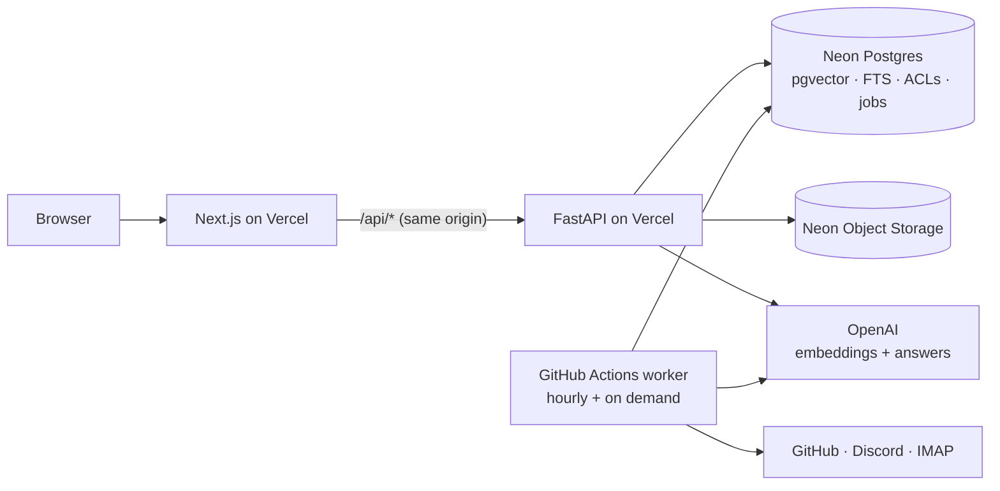

# Slate

A permission-aware knowledge assistant. Slate ingests your files, GitHub repositories, Discord servers and email. It runs hybrid (vector + keyword) search over them and answers questions with citations to the exact passage. Access is enforced inside every SQL query, so nobody ever sees content they aren't allowed to, not even through the model.

> Status: [docs/ROADMAP.md](docs/ROADMAP.md) · Demo video: _coming soon_

## What it does

- **Ask, with proof.** Every `[n]` in an answer links to a retrieved passage you're allowed to read. Markers that don't map to one are dropped before the answer is stored. When the sources don't hold the answer, Slate says so instead of guessing.
- **Connect your sources.**
  - **Uploads:** PDF, Word, Markdown, HTML, CSV and text.
  - **GitHub:** docs, issues and pull requests, through a GitHub App.
  - **Discord:** channels, threads and forum posts, through one read-only bot. Private channels work too, if you can read them yourself.
  - **Email:** IMAP for Gmail, Yahoo, iCloud and Fastmail with an app password, read-only, or an `.mbox` import.
- **Search** by meaning and by exact words, filtered by source, date and sender.
- **Private by default; sharing is explicit.**
  - Everything you connect is readable only by you.
  - You can invite people to a workspace, but they see a source only once you choose to share it.
  - Leaving a workspace deletes what you connected there.

## Architecture



- **Ports and adapters** ([ADR-0001](docs/DECISIONS.md)): `core/domain` holds pure rules, `core/ports` the protocols, `core/services` the use cases and `core/adapters` the vendors. import-linter enforces the layers in CI.
- **Postgres is the only datastore** ([ADR-0002](docs/DECISIONS.md)): documents, `halfvec(1024)` vectors with HNSW, full-text search, ACLs and the job queue (`SKIP LOCKED`).
- **Retrieval:** vector top-50 and keyword top-50, fused with reciprocal rank fusion, at most 3 chunks per document. A similarity gate plus a model sentinel decide when to abstain ([ADR-0019](docs/DECISIONS.md), [ADR-0022](docs/DECISIONS.md)).
- **Permissions:** principals such as `user:`, `workspace:` and `group:` are denormalised onto chunks. Every query filters `workspace_id AND acl && :principals` in SQL, and triggers keep chunk ACLs equal to their document's ([ADR-0006](docs/DECISIONS.md), [ADR-0026](docs/DECISIONS.md)).
- **$0 hosting:** Vercel Hobby, Neon Free, and GitHub Actions as the worker. OpenAI spend is capped at about $5 a month by four ledger-checked caps ([ADR-0021](docs/DECISIONS.md), [ADR-0029](docs/DECISIONS.md)).

## Evaluation

Retrieval and answers are measured on a synthetic corpus: a fictional company, with public and private documents and a prompt-injection fixture. Every case also runs as an outsider, and any leak fails the run. Method: [docs/EVALS.md](docs/EVALS.md).

<!-- eval-table:start -->
| Retrieval (hybrid unless noted) | Cases | Recall@10 | MRR@10 | nDCG@10 | Outsider leaks | Run |
| --- | --- | --- | --- | --- | --- | --- |
| bge-m3 | 47 | 0.894 | 0.833 | 0.845 | 0 | `2026-11-25_00e96d3_bge-m3` |
| openai | 49 | 1.000 | 0.930 | 0.947 | 0 | `2026-11-25_fa7e091_openai` |

| Answers | Cases | Abstention accuracy | Citation validity | Injection followed | Cost | Run |
| --- | --- | --- | --- | --- | --- | --- |
| gpt-4o-mini | 7 | 1.000 | 1.000 | 0 | $0.0010 | `2026-11-25_fa7e091_answers` |
<!-- eval-table:end -->

The answers row above is a targeted 7-case re-run. The full 53-case run scored abstention accuracy 0.943 and citation validity 1.000, with no injection followed ([EVALS.md](docs/EVALS.md#results)). Regenerate the table with `uv run python scripts/eval_table.py --write`.

## Run locally

Requires [uv](https://docs.astral.sh/uv/), Node 22+ and pnpm. No Docker: development uses a Neon branch.

```bash
cp .env.example .env          # DATABASE_URL / DATABASE_URL_DIRECT (a Neon dev branch), SESSION_SECRET,
                              # OPENAI_API_KEY for answers, CREDENTIALS_FERNET_KEY for email
uv sync && pnpm -C web install
uv run alembic upgrade head   # uses the direct, non-pooled URL
uv run python -m api.dev --reload     # API at http://127.0.0.1:8000 (docs at /docs)
pnpm -C web dev                       # web at http://localhost:3000 (proxies /api/*)
```

Connectors need their own setup (a GitHub App, a Discord application and bot, an encryption key); see `.env.example`. More commands are in [CLAUDE.md](CLAUDE.md#commands).

```bash
uv run ruff check . && uv run pyright && uv run lint-imports && uv run pytest -m "not integration"
pnpm -C web lint && pnpm -C web typecheck && pnpm -C web test
```

## Design decisions

| Decision | Why |
| --- | --- |
| [ADR-0002](docs/DECISIONS.md) Postgres for everything | ACLs and content change in one transaction; no sync between stores |
| [ADR-0012](docs/DECISIONS.md) Data classes and free-tier isolation | Private data never reaches a provider that may train on it |
| [ADR-0016](docs/DECISIONS.md) Direct-to-storage uploads | Beats Vercel's 4.5 MB body limit; the worker is the security gate |
| [ADR-0022](docs/DECISIONS.md) Abstention by gate + sentinel | RRF scores are rank-only, so they can't be thresholded |
| [ADR-0023](docs/DECISIONS.md) GitHub App with ownership proof | Installation ids are sequential, so the user's OAuth view proves ownership |
| [ADR-0026](docs/DECISIONS.md) Private by default | A future invite must never share anything silently |
| [ADR-0027](docs/DECISIONS.md) Discord over REST | Serverless can't hold a Gateway socket; windows and threads become documents |
| [ADR-0028](docs/DECISIONS.md) Email via IMAP app passwords | Gmail's API scope needs a paid security assessment; IMAP is read-only by construction |
| [ADR-0030](docs/DECISIONS.md) Shared workspaces | ChatGPT-style: invitations bound to an address, sharing only by the connector |

[Architecture](docs/ARCHITECTURE.md) · [Conventions](docs/CONVENTIONS.md) · [Security](docs/SECURITY.md) · [Evals](docs/EVALS.md) · [Decisions](docs/DECISIONS.md) · [UI design](docs/UI_DESIGN.md)
