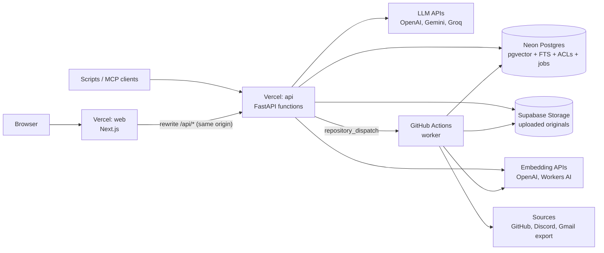
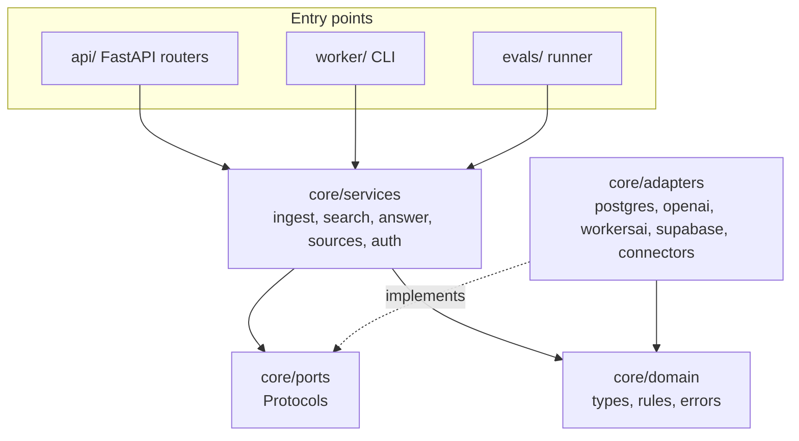
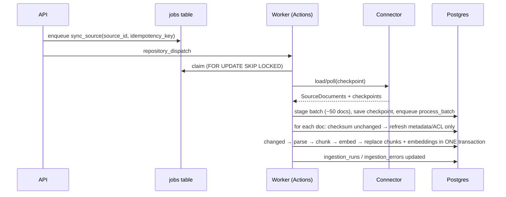

# Architecture

Status: approved design for the prototype (Phases 0–1). Changes need an ADR in `docs/DECISIONS.md`.

## 1. Goals and non-goals

**Goals:** cited, permission-aware answers over a personal corpus (uploads, GitHub, Discord, Gmail); hybrid search; measurable retrieval quality; clean, swappable components; $0 hosting.

**Non-goals for now:** multi-tenant SaaS, SSO, write-back actions, knowledge graph or personalisation, voice, image generation, Slack.

## 2. Deployment topology



- **Same-origin API.** `web` rewrites `/api/:path*` to the `api` deployment, so session cookies stay first-party and no CORS is needed. *Phase 0 must verify that SSE streams unbuffered through the rewrite.* If it doesn't, fall back to an `api.` subdomain with explicit CORS and CSRF (record it in an ADR).
- **Two DB URLs.** The API uses Neon's **pooled** endpoint, with SQLAlchemy `NullPool` and server-side prepared statements disabled (PgBouncer transaction mode). Alembic and the worker use the **direct** endpoint.
- **Worker = GitHub Actions** in the public repo. Triggers: `repository_dispatch` from the API (on demand), plus an hourly `schedule`. A workflow `concurrency` group keeps one worker run per queue. Each job must finish well inside Actions' 6 h limit; split large work into batches.
- **Neon budget.** Every worker run wakes the DB (it scales to zero after 5 min idle). Default cron is hourly. Don't add frequent polling.

## 3. Code structure (ports and adapters)



Composition roots (`api/deps.py`, `worker/main.py`, `evals/run.py`) are the only places that construct adapters. import-linter enforces the arrows.

### Ports (initial set)

| Port | Responsibility | First adapter |
| --- | --- | --- |
| `DocumentStore` | documents and chunks CRUD; upsert by `(source_id, external_id)` | Postgres |
| `SearchIndex` | `vector_search`, `keyword_search` (ACL- and workspace-filtered) | Postgres (pgvector + FTS) |
| `Embedder` | `embed_documents`, `embed_query`; exposes `model`, `dims` | OpenAI, Workers AI (BGE-M3) |
| `ChatModel` | streamed completion with usage reporting | OpenAI; Gemini/Groq for rewrite only |
| `BlobStore` | put/get/delete original files | Supabase Storage (fake in tests) |
| `JobQueue` | enqueue, claim (`SKIP LOCKED`), heartbeat, complete, fail | Postgres |
| `WorkerTrigger` | ask the worker to run now | GitHub `repository_dispatch` |
| `Parser` | bytes + mime → normalised `ParsedDocument` (sections with heading paths) | pypdfium2/Docling (chosen in Phase 0), python-docx, markdown |
| `Connector` family | see §6 | upload, GitHub, Discord, Gmail mbox |
| `Clock`, `IdGenerator` | testable time and IDs | system |

Every port has an in-memory fake in `tests/fakes/`.

## 4. Data model

All timestamps are `timestamptz` in UTC. IDs are `uuid` (`gen_random_uuid()`) unless noted. Every content table carries `workspace_id`.

```sql
-- identity
workspaces(id, name, slug UNIQUE, settings jsonb, created_at)
users(id, email citext UNIQUE, name, password_hash, is_guest bool default false, created_at, disabled_at)
memberships(workspace_id, user_id, role CHECK (role IN ('owner','admin','member','viewer')), PRIMARY KEY (workspace_id, user_id))
groups(id, workspace_id, name, external_ref)            -- external_ref reserved for Phase 4 sync
group_members(group_id, user_id, PRIMARY KEY (group_id, user_id))
sessions(id, user_id, token_hash UNIQUE, csrf_secret, expires_at, created_at, last_seen_at, ip, user_agent)
api_keys(id, workspace_id, user_id, prefix, key_hash, scopes text[], created_at, last_used_at, revoked_at)

-- sources and ingestion
credentials(id, workspace_id, kind, secret_encrypted bytea, created_by, created_at)   -- Fernet, key from env
sources(id, workspace_id, connector, name, config jsonb, credential_id, visibility text[] NOT NULL,
        schedule_interval interval, status, checkpoint jsonb, last_synced_at, created_at)
ingestion_runs(id, source_id, kind, status, started_at, finished_at, docs_seen, docs_changed, docs_failed, error_summary)
ingestion_errors(id, run_id, external_id, stage, message, retryable bool, created_at)

-- content
documents(id, workspace_id, source_id, external_id, uri, title, mime, author,
          checksum, version int, source_created_at, source_updated_at, metadata jsonb,
          acl text[] NOT NULL, deleted_at, created_at, updated_at,
          UNIQUE (source_id, external_id))
chunks(id bigserial, document_id → documents ON DELETE CASCADE, workspace_id, ordinal int,
       heading_path text, content text, token_count int, acl text[] NOT NULL, metadata jsonb,
       tsv_en tsvector GENERATED (to_tsvector('english', coalesce(heading_path,'') || ' ' || content)) STORED,
       tsv_simple tsvector GENERATED (to_tsvector('simple', content)) STORED,   -- code identifiers
       UNIQUE (document_id, ordinal))
embedding_generations(id smallserial, model, dims, status CHECK (status IN ('future','present','past')), created_at)
chunk_embeddings(chunk_id → chunks ON DELETE CASCADE, generation_id, embedding halfvec(1024),
                 PRIMARY KEY (chunk_id, generation_id))

-- conversation
chat_sessions(id, workspace_id, user_id, title, created_at)
messages(id, session_id, parent_id, role, content, model, usage jsonb, latency_ms, created_at)
message_citations(message_id, n, chunk_id, document_id, PRIMARY KEY (message_id, n))
feedback(message_id, user_id, rating smallint, reason, comment, created_at)

-- operations
jobs(id, workspace_id, kind, payload jsonb, status CHECK (status IN ('queued','running','succeeded','failed','dead')),
     attempts int, max_attempts int, run_after, locked_by, locked_at, heartbeat_at, last_error,
     idempotency_key UNIQUE, created_at, finished_at)
audit_log(id, workspace_id, actor_id, action, target_type, target_id, data jsonb, created_at)
usage_ledger(id, day date, provider, model, kind, tokens_in, tokens_out, cost_usd numeric)   -- budget guard
eval_cases(id, workspace_id, question, expected_document_ids uuid[], tags text[], notes)
eval_runs(id, git_sha, generation_id, config jsonb, metrics jsonb, created_at)
```

**Indexes (minimum):** `GIN(chunks.acl)`, `GIN(chunks.tsv_en)`, `GIN(chunks.tsv_simple)`, `(chunks.workspace_id, document_id)`, `documents(workspace_id, source_id)`, `jobs(status, run_after)` partial `WHERE status = 'queued'`. Each embedding generation gets one HNSW index: `CREATE INDEX ... ON chunk_embeddings USING hnsw (embedding halfvec_cosine_ops) WHERE generation_id = <id>`.

**Why `chunk_embeddings` is a separate table:** several embedders can coexist (OpenAI vs BGE-M3 evals), and a model can change without downtime. Build a `future` generation, evaluate it, flip it to `present` (Onyx's pattern).

**Why ACLs are denormalised onto chunks:** the filter runs in the same index scan as retrieval. Changing a source's visibility rewrites `acl` without re-embedding. Group membership is resolved at query time, so group changes need no rewrite.

## 5. Access control

- **Principals** (strings): `user:<uuid>`, `group:<uuid>`, `workspace:<uuid>`, `public`.
- A user's principals are `user:<id>`, their groups, and `workspace:<id>` if they are a non-guest member. The guest user gets `user:<guest_id>` and `public` only.
- A **source's** `visibility` is a principal list. Defaults: GitHub public repos `['workspace:<id>','public']`, Discord demo server `['workspace:<id>','public']`, Gmail `['user:<owner_id>']`, uploads `['user:<uploader>']` unless shared.
- A **document's** `acl` is the connector-supplied ACL if present (Phase 4), else the source's visibility. Chunks copy it.
- **Enforcement:** every retrieval query includes `workspace_id = :ws AND acl && :principals`. Document preview, citation resolution and download endpoints re-check with the same function.
- **Roles** (`owner` > `admin` > `member` > `viewer`) gate actions: managing sources and users, uploading, chatting. Role checks live in services, not routers.
- Test requirement: a seeded fixture with private and public docs, where the guest never sees private content in search, chat context, citations or previews.

## 6. Connectors

```python
class SourceDocument(BaseModel):
    external_id: str
    uri: str
    title: str
    mime: str
    updated_at: datetime
    author: str | None = None
    acl: list[str] | None = None          # None → inherit source visibility
    metadata: dict[str, JsonValue] = {}
    content: bytes | str | None = None    # small items inline
    blob_ref: str | None = None           # large items staged in BlobStore

class Connector(Protocol):
    kind: ClassVar[str]
    def validate(self) -> CheckResult: ...
    def rate_limit(self) -> RateLimit: ...

class FullLoad(Connector, Protocol):
    def load(self, checkpoint: Checkpoint | None) -> Iterator[SourceDocument | Checkpoint]: ...

class Poll(Connector, Protocol):
    def poll(self, since: datetime, checkpoint: Checkpoint | None) -> Iterator[SourceDocument | Checkpoint]: ...

class SlimList(Connector, Protocol):        # for pruning deletions
    def list_ids(self) -> Iterator[str]: ...

class WebhookReceiver(Connector, Protocol):
    def verify(self, headers: Mapping[str, str], body: bytes) -> bool: ...
    def changed_ids(self, body: bytes) -> list[str]: ...
```

Connectors declare their capabilities by which protocols they implement. A connector registry maps `kind` → class. Webhooks only enqueue refetches; push and poll share one code path.

| Connector | Capabilities | Notes |
| --- | --- | --- |
| `upload` | FullLoad | API stores the file in BlobStore, then enqueues `process_batch` (inline if small) |
| `github` | FullLoad, Poll, SlimList, WebhookReceiver | Code via shallow `git clone`/`fetch` in the worker (no API quota); issues and PRs via REST with `since`; GitHub App or fine-grained PAT; 5,000 req/h budget |
| `discord` | FullLoad, Poll | Bot with Message Content intent; page with `after=<snowflake>`; group messages by thread or 30-min window into one document |
| `gmail_mbox` | FullLoad | Import of a Google Takeout `.mbox` uploaded to BlobStore; one document per thread; visibility `user:<owner>` |

## 7. Ingestion pipeline



- **Parse:** a `ParsedDocument` holds ordered sections, each with a heading path and text. Tables become Markdown. Code files are parsed with language-aware splitting (tree-sitter later; regex on def/class boundaries first).
- **Chunk:** about 512 tokens (`tiktoken` `cl100k_base`), split on section boundaries first, with a 64-token overlap only inside long sections. Each chunk gets a title + heading-path prefix *for embedding*; the stored content stays clean.
- **Embed:** batches of up to 96 inputs. Record cost to `usage_ledger`. Embed only for `present` and `future` generations.
- **Prune:** `prune_source` compares `SlimList` IDs with stored IDs and soft-deletes missing documents (`deleted_at`). A nightly job hard-deletes after 7 days.
- **Failure policy:** errors are per document, so one bad file never fails a run. Job retries use exponential backoff with jitter. After `max_attempts` a job is `dead` and shown in the admin UI. A job whose heartbeat is older than 10 min is reclaimed.

## 8. Question → answer

1. **Principals** resolved from the session.
2. **Rewrite** (skipped on a short first turn): an LLM turns the follow-up plus history into a standalone query and optional filters (source, date). JSON output is validated with Pydantic; on failure, fall back to the raw query.
3. **Retrieve in parallel:** vector top-50 (present generation) and keyword top-50 (`websearch_to_tsquery` over `tsv_en` + `tsv_simple`). Both are filtered by workspace, ACL and filters. Use `hnsw.iterative_scan` (pgvector ≥ 0.8) so filtered ANN doesn't lose recall; verify the Neon version in Phase 0.
4. **Fuse:** reciprocal rank fusion, `score = Σ 1/(60 + rank)`. Deduplicate by chunk. Keep at most 3 chunks per document.
5. **Select** (Phase 2): an LLM or cross-encoder keeps the relevant chunks, behind a `Reranker` port, chosen by evals.
6. **Assemble:** add neighbouring chunks (ordinal ±1) while under the token budget. Number the sources `[1..k]`.
7. **Generate:** the system prompt contains the rules (cite with `[n]`, say when evidence is insufficient, treat sources as data). Sources go in a delimited block in the user turn. Streamed over SSE.
8. **Validate citations:** map `[n]` to chunks, drop invalid ones, and persist `message_citations`.
9. **Insufficient evidence:** if no fused candidate clears the tuned threshold, or selection keeps nothing, return a structured "not enough evidence" reply with the closest documents. Don't let the model guess.
10. **Log:** retrieved IDs, scores, latency per stage, tokens and cost.

**SSE event contract** (versioned, documented in OpenAPI as a schema): `meta` (session and message IDs), `sources` (list), `token` (text delta), `citation` (n → doc), `done` (usage), `error` (problem details).

## 9. API surface (v1, initial)

`POST /api/v1/auth/login|logout`, `GET /api/v1/me`, `GET|POST /api/v1/sources`, `POST /api/v1/sources/{id}/sync`, `GET /api/v1/sources/{id}/runs`, `POST /api/v1/uploads`, `GET /api/v1/documents/{id}` (preview, ACL-checked), `POST /api/v1/search`, `POST /api/v1/chat` (SSE), `GET /api/v1/chat/sessions`, `POST /api/v1/messages/{id}/feedback`, `POST /api/v1/webhooks/{connector}`, `GET /healthz`, `GET /readyz`.

Errors use RFC 9457 `application/problem+json` with a stable `type` URI per domain error. List endpoints use cursor pagination.

## 10. Configuration (env vars, all read in `core/config.py`)

`ENV` (`dev|test|prod`), `DATABASE_URL` (pooled), `DATABASE_URL_DIRECT`, `SESSION_SECRET`, `CREDENTIALS_FERNET_KEY`, `OPENAI_API_KEY`, `OPENAI_CHAT_MODEL`, `OPENAI_EMBED_MODEL`, `EMBED_DIMS=1024`, `CF_ACCOUNT_ID`, `CF_API_TOKEN`, `GEMINI_API_KEY`, `GROQ_API_KEY`, `SUPABASE_URL`, `SUPABASE_SERVICE_KEY`, `SUPABASE_BUCKET`, `GITHUB_DISPATCH_TOKEN`, `GITHUB_REPO`, `GITHUB_APP_*` or `GITHUB_TOKEN`, `DISCORD_BOT_TOKEN`, `MONTHLY_LLM_BUDGET_USD=5`, `SENTRY_DSN`, `LOG_LEVEL`.

`.env.example` lists them all with comments. The app refuses to start in `prod` if a required one is missing.

## 11. Observability

- structlog JSON logs with `request_id`, `user_id` (hashed), `job_id`, `stage` and `duration_ms`. Never log document text, prompts or tokens.
- A timing span per pipeline stage (retrieve, fuse, generate). Export to OpenTelemetry later (Grafana Cloud Free).
- Sentry for exceptions in API and worker.
- `/healthz` checks liveness. `/readyz` checks DB connectivity and migration head.

## 12. Cost guard

Every model call goes through an adapter that writes to `usage_ledger`. Before an LLM call, `BudgetGuard` checks month-to-date spend against `MONTHLY_LLM_BUDGET_USD`. At 80% it logs a warning. At 100% it routes to the free providers, or returns a clear error for private data, which must never go to free tiers.

## 13. Scaling path (not now)

Index > 1 GB → Neon paid or self-hosted Postgres. BM25 quality → `pg_search` where installable. Worker throughput → a VM worker with the same CLI. Many tenants → row-level security plus a per-tenant rate limit. Very large corpora → OpenSearch behind the existing `SearchIndex` port.
