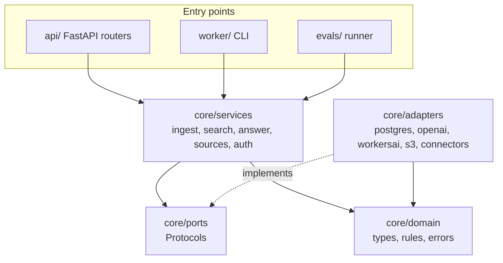
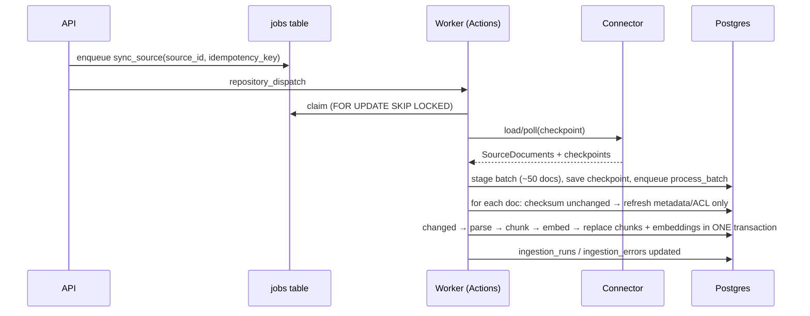

# Architecture

Status: approved design for the prototype (Phases 0–1). Changes need an ADR in `docs/DECISIONS.md`.

## 1. Goals and non-goals

**Goals:** cited, permission-aware answers over a personal corpus (uploads, GitHub, Discord, Gmail); hybrid search; measurable retrieval quality; clean, swappable components; $0 hosting.

**Non-goals for now:** multi-tenant SaaS, SSO, write-back actions, knowledge graph or personalisation, voice, image generation, Slack.

## 2. Deployment topology


- **Same-origin API.** `web` rewrites `/api/:path*` to the `api` deployment, so session cookies stay first-party and no CORS is needed. *Phase 0 must verify that SSE streams unbuffered through the rewrite.* If it doesn't, fall back to an `api.` subdomain with explicit CORS and CSRF (record it in an ADR).
- **Two DB URLs.** The API uses Neon's **pooled** endpoint with a small SQLAlchemy client pool (2 + 3 overflow, recycled every 120 s, no pre-ping; the UoW retries once on a dead connection) and server-side prepared statements disabled (PgBouncer transaction mode). See ADR-0018. Alembic and the worker use the **direct** endpoint.
- **Worker = GitHub Actions** in the public repo. Triggers: `repository_dispatch` from the API (on demand), plus an hourly `schedule`. A workflow `concurrency` group keeps one worker run per queue. Each job must finish well inside Actions' 6 h limit; split large work into batches.
- **Neon budget.** Every worker run wakes the DB (it scales to zero after 5 min idle). Default cron is hourly. Don't add frequent polling.

## 3. Code structure (ports and adapters)



Composition roots (`api/deps.py`, `worker/main.py`, `evals/run.py`) are the only places that construct adapters. import-linter enforces the arrows.

### Ports (initial set)

| Port | Responsibility | First adapter |
| --- | --- | --- |
| `DocumentStore` | documents and chunks CRUD; upsert by `(source_id, external_id)` | Postgres |
| `SearchIndex` | `vector_search`, `keyword_search` (ACL- and workspace-filtered) | Postgres (pgvector + FTS) |
| `Embedder` | `embed_documents`, `embed_query`; exposes `model`, `dims` | OpenAI, Workers AI (BGE-M3) |
| `ChatModel` | streamed completion with usage reporting | OpenAI; Gemini/Groq for rewrite only |
| `BlobStore` | put/get/delete original files | Neon Object Storage via S3 API (fake in tests) |
| `JobQueue` | enqueue, claim (`SKIP LOCKED`), heartbeat, complete, fail | Postgres |
| `WorkerTrigger` | ask the worker to run now | GitHub `repository_dispatch` |
| `Parser` | bytes + mime → normalised `ParsedDocument` (sections with heading paths) | pypdfium2/Docling (chosen in Phase 0), python-docx, markdown |
| `Connector` family | see §6 | upload, GitHub, Discord, Gmail mbox |
| `Clock`, `IdGenerator` | testable time and IDs | system |

Every port has an in-memory fake in `tests/fakes/`.

## 4. Data model

All timestamps are `timestamptz` in UTC. IDs are `uuid` (`gen_random_uuid()`) unless noted. Every content table carries `workspace_id`.

```sql
-- identity
workspaces(id, name, slug UNIQUE, settings jsonb, allows_public bool, created_at)   -- 0006: true only for the eval workspace
users(id, email citext UNIQUE, email_canonical citext UNIQUE, name, password_hash NOT NULL, email_verified_at, created_at, disabled_at)   -- 0004, ADR-0021
email_codes(user_id, purpose, code_hash bytea(32), expires_at, attempts, consumed_at, created_at, PRIMARY KEY (user_id, purpose))   -- HMAC'd one-time codes
memberships(workspace_id, user_id, role CHECK (role IN ('owner','admin','member','viewer')), PRIMARY KEY (workspace_id, user_id))
groups(id, workspace_id, name, external_ref)            -- external_ref reserved for Phase 4 sync
group_members(group_id, user_id, PRIMARY KEY (group_id, user_id))
sessions(id, user_id, workspace_id, token_hash UNIQUE, csrf_secret, expires_at, created_at, last_seen_at, ip, user_agent)   -- 0008: active workspace
invitations(id, workspace_id, email_canonical, role, token_hash UNIQUE, invited_by, created_at, expires_at, accepted_at, revoked_at)   -- 0008
api_keys(id, workspace_id, user_id, prefix, key_hash, scopes text[], created_at, last_used_at, revoked_at)

-- sources and ingestion
credentials(id, workspace_id, kind, secret_encrypted bytea, created_by, created_at)   -- Fernet, key from env
sources(id, workspace_id, connector, name, config jsonb, credential_id, created_by, visibility text[] NOT NULL,
        data_class DEFAULT 'private',             -- ADR-0012: public only if 'public' ∈ visibility; gmail always private
        schedule_interval interval, status, checkpoint jsonb, last_synced_at, created_at)
ingestion_runs(id, source_id, kind, status, started_at, finished_at, docs_seen, docs_changed, docs_failed, error_summary)
ingestion_errors(id, run_id, external_id, stage, message, retryable bool, created_at)

-- content
documents(id, workspace_id, source_id, external_id, uri, title, mime, author,
          checksum, version int, source_created_at, source_updated_at, metadata jsonb,
          acl text[] NOT NULL, data_class, deleted_at, created_at, updated_at,
          UNIQUE (source_id, external_id))
chunks(id bigserial, document_id → documents ON DELETE CASCADE, workspace_id, ordinal int,
       heading_path text, content text, token_count int, acl text[] NOT NULL, data_class, metadata jsonb,
       tsv_en tsvector GENERATED (to_tsvector('english', coalesce(heading_path,'') || ' ' || content)) STORED,
       tsv_simple tsvector GENERATED (to_tsvector('simple', content)) STORED,   -- code identifiers
       UNIQUE (document_id, ordinal))
embedding_generations(id smallserial, model, dims, status CHECK (status IN ('future','present','past')),
                      data_scope CHECK (data_scope IN ('all','public')), created_at)   -- ADR-0012/0013
chunk_embeddings(chunk_id → chunks ON DELETE CASCADE, generation_id, embedding halfvec(1024),
                 PRIMARY KEY (chunk_id, generation_id))

-- conversation
chat_sessions(id, workspace_id, user_id, title, created_at)
messages(id, session_id, parent_id, role, content, model, usage jsonb, latency_ms, created_at,
         superseded_at)   -- regenerate/edit retire turns instead of deleting them (ADR-0024)
message_citations(message_id, n, chunk_id, document_id, PRIMARY KEY (message_id, n))
feedback(message_id, user_id, rating smallint, reason, comment, created_at)

-- operations
jobs(id, workspace_id, kind, payload jsonb, status CHECK (status IN ('queued','running','succeeded','failed','dead')),
     attempts int, max_attempts int, run_after, locked_by, locked_at, heartbeat_at, last_error,
     idempotency_key UNIQUE, created_at, finished_at)
audit_log(id, workspace_id, actor_id, action, target_type, target_id, data jsonb, created_at)
usage_ledger(id, day date, provider, model, kind, data_class, tokens_in, tokens_out, cost_usd numeric)   -- budget guard + isolation audit
eval_cases(id, workspace_id, question, expected_document_ids uuid[], tags text[], notes)
eval_runs(id, git_sha, generation_id, config jsonb, metrics jsonb, created_at)
```

**Constraints:** every status/kind/role column has a CHECK; at most one `present` and one `future` embedding generation (partial unique indexes, ADR-0013); `data_class = 'public'` requires `'public'` in the ACL (ADR-0012). The exact DDL is `migrations/versions/0001_initial_schema.py`.

**Indexes (minimum):** `GIN(chunks.acl)`, `GIN(chunks.tsv_en)`, `GIN(chunks.tsv_simple)`, `(chunks.workspace_id, document_id)`, `documents(workspace_id, source_id)`, `jobs(run_after, created_at)` partial `WHERE status IN ('queued','failed')` (claim), `jobs(heartbeat_at) WHERE status = 'running'` (reclaim), plus list indexes for runs, sessions, messages and the audit log. Each embedding generation gets one HNSW index: `CREATE INDEX ... ON chunk_embeddings USING hnsw (embedding halfvec_cosine_ops) WHERE generation_id = <id>`.

**Why `chunk_embeddings` is a separate table:** several embedders can coexist (OpenAI vs BGE-M3 evals), and a model can change without downtime. Build a `future` generation, evaluate it, flip it to `present` (Onyx's pattern).

**Why ACLs are denormalised onto chunks:** the filter runs in the same index scan as retrieval. Changing a source's visibility rewrites `acl` without re-embedding. Group membership is resolved at query time, so group changes need no rewrite.

## 5. Access control

- **Principals** (strings): `user:<uuid>`, `group:<uuid>`, `workspace:<uuid>`, `public`.
- **Accounts (ADR-0021):** anyone can sign up; each account gets its own workspace and is its `owner`, so users are isolated by `workspace_id` before any ACL applies. A user's principals are `user:<id>`, `workspace:<id>`, their groups and `public`. `Principals.for_outsider` (`user:<id>`, `public`) models someone entitled to nothing but public content; the isolation tests use it.
- A **source's** `visibility` is a principal list. **Private by default (ADR-0026):** a connected source (GitHub, Discord, Gmail) is `['user:<connector>']` (`sources.created_by`); uploads are `['user:<uploader>']` unless the uploader chooses "Workspace". Sharing with workspace members is always an explicit act (invites, M7). The `public` principal and `data_class='public'` exist only in the synthetic eval workspace (`workspaces.allows_public`, enforced by triggers).
- A **document's** `acl` is the connector-supplied ACL if present (Phase 4), else the source's visibility. Chunks copy it.
- **Enforcement:** every retrieval query includes `workspace_id = :ws AND acl && :principals`. Document preview, citation resolution and download endpoints re-check with the same function.
- **Roles** (`owner` > `admin` > `member` > `viewer`) gate actions: managing sources and users, uploading, chatting. Role checks live in services, not routers.
- **Shared workspaces (ADR-0030):** an account has its own workspace and may join others by an invitation bound to its email address. The session's active workspace is re-checked against `memberships` on every request. A source becomes visible to members only when its connector shares it (`PUT /sources/{id}/sharing`). Leaving deletes what that person connected there.
- **Verification:** an account must verify its email (6-digit code) before it can change data or spend money; until then it can only verify, resend and sign out.
- Test requirement: a seeded fixture with private and public docs, where an outsider never sees private content in search, chat context, citations or previews, and another account sees nothing from this workspace at all.

## 6. Connectors

```python
class SourceDocument(BaseModel):
    external_id: str
    uri: str
    title: str
    mime: str
    updated_at: datetime
    author: str | None = None
    acl: list[str] | None = None          # None → inherit source visibility
    metadata: dict[str, JsonValue] = {}
    content: bytes | str | None = None    # small items inline
    blob_ref: str | None = None           # large items staged in BlobStore

class Connector(Protocol):
    kind: ClassVar[str]
    def validate(self) -> CheckResult: ...
    def rate_limit(self) -> RateLimit: ...

class FullLoad(Connector, Protocol):
    def load(self, checkpoint: Checkpoint | None) -> Iterator[SourceDocument | Checkpoint]: ...

class Poll(Connector, Protocol):
    def poll(self, since: datetime, checkpoint: Checkpoint | None) -> Iterator[SourceDocument | Checkpoint]: ...

class SlimList(Connector, Protocol):        # for pruning deletions
    def list_ids(self) -> Iterator[str]: ...

class WebhookReceiver(Connector, Protocol):
    def verify(self, headers: Mapping[str, str], body: bytes) -> bool: ...
    def changed_ids(self, body: bytes) -> list[str]: ...
```

Connectors declare their capabilities by which protocols they implement. A connector registry maps `kind` → class. Webhooks only enqueue refetches; push and poll share one code path.

| Connector | Capabilities | Notes |
| --- | --- | --- |
| `upload` | (API-driven) | Direct-to-storage, two steps (ADR-0016): `POST /uploads` checks role, size, type and duplicates and returns a size-limited presigned POST plus a signed upload token; the browser sends the file straight to the bucket; `POST /uploads/complete` checks size and sniffs the first 8 KB, then enqueues `process_upload`. The worker re-verifies the sha256 |
| `github` | FullLoad, Poll, SlimList | GitHub App (ADR-0023): the installation is verified as the user's through OAuth during install. Docs come from one tarball per changed default branch, issues and PRs via REST with `since`; one source per repo; unchanged files skipped by checksum, deleted files pruned; hourly, plus "Sync now" inline (90 s, then the worker). No code and no webhooks in M4 |
| `discord` | FullLoad, Poll | One Slate bot (ADR-0027), added through Discord's OAuth flow, which proves Manage Server; the user's own roles decide which channels they may pick (private ones included). REST only: a 90-day backfill, then `after=<snowflake>` with a 48 h re-read. One document per thread or 30-minute window; pruning after complete passes; hourly, plus "Sync now" inline |
| `imap` | Poll | ADR-0028: a mailbox from a fixed provider list (Gmail, Yahoo, iCloud, Fastmail), app password Fernet-encrypted in `credentials`. Inbox + Sent read-only (EXAMINE, BODY.PEEK); 90 days / 2,000 conversations first, then UIDs after the cursor; one document per conversation (X-GM-THRID or References root); hourly |
| `gmail_mbox` | FullLoad | A 25 MB `.mbox` upload (job `import_mbox`) split into the same thread documents in the user's "Email import" source; the file is deleted after import |

## 7. Ingestion pipeline



- **Verify (uploads):** the worker downloads the object once (capped at 25 MB) and checks its SHA-256 and type on those exact bytes before parsing them (ADR-0016). Unchanged uploads (same SHA-256 already indexed) skip download and embedding.
- **Parse:** a `ParsedDocument` holds ordered sections, each with a heading path and text. Parsers: pypdfium2 (PDF, text only; scans need OCR later), python-docx (with zip-bomb checks), markdown-it, BeautifulSoup, csv. Tables become Markdown. Code files are parsed with language-aware splitting (tree-sitter later; regex on def/class boundaries first).
- **Chunk:** about 512 tokens (`tiktoken` `cl100k_base`), split on section boundaries first, with a 64-token overlap only inside long sections. Each chunk gets a title + heading-path prefix *for embedding*; the stored content stays clean.
- **Embed:** batches of up to 96 inputs. Record cost and data class to `usage_ledger`. The budget guard runs before the first paid call. The first embedding registers the `present` generation and its HNSW index.
- **Backfill (new generations):** `python -m worker backfill` builds a `future` generation from stored chunks: keyset-paged over chunks with no vector in it, `ON CONFLICT DO NOTHING`, capped per run, so it is idempotent and resumable. A free-tier embedder (BGE-M3 on Workers AI) only builds `public`-scoped generations (ADR-0012, ADR-0020). Search keeps serving `present`; evals measure the `future` one before a flip.
- **Inline path:** uploads up to 1 MB are processed inside the `complete` request by claiming that exact job (`claim_by_id`); retryable failures fall back to the worker.
- **Prune:** `prune_source` compares `SlimList` IDs with stored IDs and soft-deletes missing documents (`deleted_at`). A nightly job hard-deletes after 7 days.
- **Failure policy:** errors are per document, so one bad file never fails a run. Job retries use exponential backoff with jitter. After `max_attempts` a job is `dead` and shown in the admin UI. A job whose heartbeat is older than 10 min is reclaimed.

## 8. Question → answer

1. **Principals** resolved from the session. A `replace_from` (regenerate or edit) supersedes that question and everything after it before history is read (ADR-0024). **Small talk** (rule-based `is_small_talk`) skips steps 2–9 and gets one short reply: mode `chat` (ADR-0025).
2. **Rewrite** (skipped on a short first turn): an LLM turns the follow-up plus history into a standalone query and optional filters (source, date). JSON output is validated with Pydantic; on failure, fall back to the raw query.
3. **Retrieve in parallel** (`hybrid_retrieve`, ADR-0019): vector top-50 (present generation) and keyword top-50 over `tsv_en` + `tsv_simple`. A plain query matches any of its words, ranked by `ts_rank_cd`; a query with search syntax (quotes, `-word`, `or`) uses `websearch_to_tsquery`. Both are filtered by workspace, ACL, live document, non-deleting source and filters, inside the query. `hnsw.iterative_scan = relaxed_order` keeps filtered ANN from losing recall (ADR-0011). If the vector lane can't run (no generation, no embedder, budget spent, embedder down), search returns keyword results and says so.
4. **Fuse:** reciprocal rank fusion, `score = Σ 1/(60 + rank)`. Deduplicate by chunk. Keep at most 3 chunks per document.
5. **Gate** (ADR-0022, ADR-0025): no passages, or a best vector similarity below `CHAT_MIN_SIMILARITY`, skips the sources: the model gets the question alone under `GENERAL_PROMPT` and either answers from general knowledge (mode `general`, labelled in the UI, no citations) or replies `NO_ANSWER`. **Select** (Phase 2): an LLM or cross-encoder keeps the relevant chunks, behind a `Reranker` port, chosen by evals.
6. **Assemble:** the top 8 passages, each widened with neighbouring chunks (ordinal ±1, fetched through `search.py` under the same ACL rule) while under a 3,000-token budget. Number the sources `[1..k]`.
7. **Generate:** the system prompt contains the rules (cite with `[n]`, say when evidence is insufficient, treat sources as data). Sources go in a delimited block in the user turn. Streamed over SSE.
8. **Validate citations:** map `[n]` to chunks, drop invalid ones, and persist `message_citations`.
9. **Modes and insufficient evidence:** the reply's first line decides the mode: `GENERAL_ANSWER` means a general answer (citations dropped), `NO_ANSWER` means abstain, and anything else is a grounded answer. Neither sentinel is ever streamed. `NO_ANSWER` (from either prompt) gives the designed "not enough evidence" reply with the closest documents: `done` with `abstained: true`. Fused RRF scores are rank-only, so they can't be thresholded (ADR-0022).
10. **Log:** retrieved IDs, scores, latency per stage, tokens and cost.

**SSE event contract v1** (documented in OpenAPI as `ChatEvents`; every `data` is JSON with `v: 1`): `meta` (session and user-message IDs), `sources` (numbered passages), `token` (text delta), `citation` (n -> chunk and document, sent once n is confirmed), `done` (message ID, `abstained`, `mode` grounded|general|chat, model, latency, citations, closest matches, notices), `error` (problem fields plus request ID). Checks that can fail run before the stream opens and return problem+json. SSE streams unbuffered through the Vercel rewrite (ADR-0010 spike).

## 9. API surface (v1, initial)

`GET /api/v1/auth/config`, `POST /api/v1/auth/signup|login|logout`, `POST /api/v1/auth/verify`, `POST /api/v1/auth/verify/resend`, `POST /api/v1/auth/password/forgot|reset`, `GET /api/v1/me`, `GET|POST /api/v1/sources`, `GET /api/v1/sources/github/status`, `POST /api/v1/sources/github/install|installations|repos|connect`, `GET /api/v1/sources/discord/status`, `POST /api/v1/sources/discord/install|installations|channels|connect`, `GET /api/v1/sources/email/status`, `POST /api/v1/sources/email/connect`, `GET /api/v1/workspaces`, `POST /api/v1/workspaces/switch`, `GET|PATCH|DELETE /api/v1/workspaces/members[/{user_id}]`, `GET|POST|DELETE /api/v1/workspaces/invites[/{id}]`, `POST /api/v1/invites/accept`, `PUT /api/v1/sources/{id}/sharing`, `POST /api/v1/sources/{id}/sync`, `DELETE /api/v1/sources/{id}`, `GET /api/v1/sources/{id}/runs`, `POST /api/v1/uploads`, `POST /api/v1/uploads/complete`, `GET /api/v1/documents/{id}` (preview, ACL-checked), `POST /api/v1/search`, `POST /api/v1/chat` (SSE), `GET /api/v1/chat/sessions`, `GET /api/v1/chat/sessions/{id}/messages`, `POST /api/v1/messages/{id}/feedback`, `POST /api/v1/webhooks/{connector}`, `GET /healthz`, `GET /readyz`.

Errors use RFC 9457 `application/problem+json` with a stable `type` URI per domain error. List endpoints use cursor pagination.

## 10. Configuration (env vars, all read in `core/config.py`)

`ENV` (`dev|test|prod`), `OWNER_EMAIL`, `SETUP_TOKEN`, `SIGNUPS_ENABLED`, `SMTP_HOST|PORT|SECURITY|USERNAME|PASSWORD`, `MAIL_FROM`, `TURNSTILE_SITE_KEY`, `TURNSTILE_SECRET_KEY`, `DAILY_LLM_BUDGET_USD`, `WORKSPACE_MONTHLY_BUDGET_USD`, `WORKSPACE_DAILY_BUDGET_USD`, `DATABASE_URL` (pooled), `DATABASE_URL_DIRECT`, `SESSION_SECRET`, `CREDENTIALS_FERNET_KEY`, `OPENAI_API_KEY`, `OPENAI_CHAT_MODEL` (default gpt-4o-mini), `CHAT_MIN_SIMILARITY`, `OPENAI_EMBED_MODEL`, `EMBED_DIMS=1024`, `CF_ACCOUNT_ID`, `CF_API_TOKEN`, `GEMINI_API_KEY`, `GROQ_API_KEY`, `AWS_ACCESS_KEY_ID`, `AWS_SECRET_ACCESS_KEY`, `AWS_ENDPOINT_URL_S3`, `AWS_REGION`, `UPLOADS_BUCKET` (Neon Object Storage, ADR-0014), `GITHUB_DISPATCH_TOKEN`, `GITHUB_REPO`, `GITHUB_APP_ID`, `GITHUB_APP_SLUG`, `GITHUB_APP_CLIENT_ID`, `GITHUB_APP_CLIENT_SECRET`, `GITHUB_APP_PRIVATE_KEY` (ADR-0023), `DISCORD_BOT_TOKEN`, `DISCORD_CLIENT_ID`, `DISCORD_CLIENT_SECRET`, `DISCORD_REDIRECT_URI` (ADR-0027), `MONTHLY_LLM_BUDGET_USD=5`, `SENTRY_DSN`, `LOG_LEVEL`.

`.env.example` lists them all with comments. The app refuses to start in `prod` if a required one is missing.

## 11. Observability

- structlog JSON logs with `request_id`, `user_id` (hashed), `job_id`, `stage` and `duration_ms`. Never log document text, prompts or tokens.
- A timing span per pipeline stage (retrieve, fuse, generate). Export to OpenTelemetry later (Grafana Cloud Free).
- Sentry for exceptions in API and worker.
- `/healthz` checks liveness. `/readyz` checks DB connectivity and migration head.

## 12. Cost guard

Every model call goes through an adapter that writes to `usage_ledger`. Before a paid call, the caller checks four caps in one ledger query (`core/domain/budget.py`, ADR-0021): global per month (`MONTHLY_LLM_BUDGET_USD`, the hard stop), global per day, and per workspace per month and per day. At 80% of the monthly cap it logs a warning. Only verified accounts may spend at all. At 100% it routes to the free providers, or returns a clear error for private data, which must never go to free tiers.

## 13. Scaling path (not now)

Index > 1 GB → Neon paid or self-hosted Postgres. BM25 quality → `pg_search` where installable. Worker throughput → a VM worker with the same CLI. Many tenants → row-level security plus a per-tenant rate limit. Very large corpora → OpenSearch behind the existing `SearchIndex` port.
